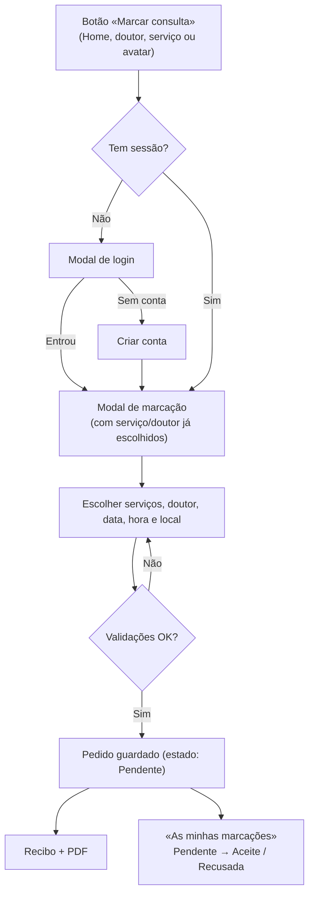

# Mundo-Hospitalar

Site de uma unidade hospitalar, feito só com **HTML, CSS e JavaScript** (sem frameworks nem _build_). Permite conhecer o hospital, os doutores e os serviços, criar uma conta e **marcar consultas online**, com recibo em PDF.

> Projeto de portfólio. Os dados (doutores, serviços, preços, contactos) são fictícios e o "servidor" é o `localStorage` do navegador. Ver [Limitações](#limitações-conhecidas).

---

## Índice

- [Funcionalidades](#funcionalidades)
- [Tecnologias](#tecnologias)
- [Estrutura do projeto](#estrutura-do-projeto)
- [Como executar](#como-executar)
- [Como funciona](#como-funciona)
  - [Uma só versão de cada página](#uma-só-versão-de-cada-página)
  - [Componentes partilhados](#componentes-partilhados)
  - [Fluxo de marcação](#fluxo-de-marcação)
- [Dados e armazenamento](#dados-e-armazenamento)
- [Regras e validações](#regras-e-validações)
- [Acessibilidade e responsividade](#acessibilidade-e-responsividade)
- [Como personalizar](#como-personalizar)
- [Decisões de projeto](#decisões-de-projeto)
- [Limitações conhecidas](#limitações-conhecidas)
- [Próximos passos](#próximos-passos)
- [Autor](#autor)

---

## Funcionalidades

**Para qualquer visitante**

- Página inicial com apresentação, doutores, serviços, números do hospital e carrossel de testemunhos.
- Página **Sobre nós** (missão, visão e história).
- Página **Doutores**: lista de cartões; ao clicar abre um modal com o perfil (experiência, formação, idiomas, horário e local).
- Página **Serviços**: tabela com pesquisa por nome (ignora acentos); ao clicar abre um modal com descrição, preço, horário, duração e preparação.
- **Criar conta** com validação completa de todos os campos.
- **Login** em modal, em qualquer página.

**Para quem tem conta**

- O mesmo header passa a mostrar um **avatar** com menu: marcar consulta, as minhas marcações, editar perfil e sair.
- **Marcar consulta** num único modal, com:
  - um ou **vários serviços** na mesma marcação;
  - doutor à escolha (ou "Escolha Do Hospital");
  - data e hora validadas contra os dias e o horário dos serviços;
  - local: **no hospital** ou **ao domicílio** (com endereço e acréscimo de preço);
  - quadro de preços em tempo real;
  - **recibo** (comprovativo) com opção de descarregar em **PDF**.
- **As minhas marcações**, com o estado de cada pedido (Pendente, Aceite, Recusada).
- **Editar perfil**: formulário preenchido, só guarda o que mudou, pede a password atual para mudar o email ou a password.

---

## Tecnologias

| Área          | O que foi usado                                                                                                |
| ------------- | -------------------------------------------------------------------------------------------------------------- |
| Marcação      | HTML5 semântico (`header`, `main`, `section`, `dialog`, `table`, `fieldset`, `address`…)                       |
| Estilo        | CSS3 puro: variáveis, `grid`, `flex`, `clamp()`, `:has()`, _media queries_                                     |
| Lógica        | JavaScript (ES5/ES6+), sem dependências                                                                        |
| Armazenamento | `localStorage` (contas e marcações) e `sessionStorage` (marcação em curso)                                     |
| Ícones        | [Font Awesome](https://fontawesome.com/) 6 (ficheiros locais)                                                  |
| PDF do recibo | [html2pdf.js](https://github.com/eKoopmans/html2pdf.js) 0.10.1, carregado do cdnjs **só quando se pede o PDF** |

Não há `npm`, bundlers nem transpilação: abre-se e funciona.

---

## Estrutura do projeto

```text
.
├── index.html            Home
├── sobre_nos.html        Sobre nós
├── dotores.html          Doutores (lista + modal de perfil)
├── servico.html          Serviços (tabela + pesquisa + modal)
├── cadastrarUser.html    Criar conta
├── pageEditar.html       Editar perfil (exige sessão)
│
├── assets/
│   ├── css/
│   │   ├── layout.css        Header, avatar/menu, footer e modal de login (partilhado)
│   │   ├── marcacao.css      Modais de marcação, recibo e "as minhas marcações"
│   │   ├── cadastro.css      Cartão e campos de formulário (cadastro e edição)
│   │   ├── editar.css        Extras da página de edição
│   │   ├── index.css         Estilos da Home
│   │   ├── sobre_nos.css     Estilos do Sobre nós
│   │   ├── dotores.css       Estilos dos Doutores
│   │   └── servico.css       Estilos dos Serviços
│   ├── fonts/                Font Awesome (local)
│   └── img/                  Imagens
│
└── js/
    ├── layout.js             Header, footer, login, sessão e "marcar consulta"
    ├── validacoes.js         Validações e normalização partilhadas
    ├── cadastro.js           Criar conta
    ├── editarPerfil.js       Editar perfil
    ├── marcacao.js           Marcação de consultas, recibo/PDF, minhas marcações
    ├── doutores-data.js      Dados dos doutores
    ├── doutores-lista.js     Lista e modal de doutores
    ├── servicos-data.js      Dados dos serviços
    ├── servicos-lista.js     Tabela, pesquisa e modal de serviços
    └── testemunhos.js        Carrossel de testemunhos
```

> A Home (`index.html`) também carrega `assets/css/main.css` e `assets/css/heading.css`, que são estilos globais do projeto original.

### O que cada página carrega

| Página               | Scripts                                                                                                |
| -------------------- | ------------------------------------------------------------------------------------------------------ |
| `index.html`         | `layout.js`, `testemunhos.js`                                                                          |
| `sobre_nos.html`     | `layout.js`, `testemunhos.js`                                                                          |
| `dotores.html`       | `layout.js`, `doutores-data.js`, `servicos-data.js`, `doutores-lista.js`, `marcacao.js`                |
| `servico.html`       | `layout.js`, `servicos-data.js`, `doutores-data.js`, `servicos-lista.js`, `marcacao.js`                |
| `cadastrarUser.html` | `layout.js`, `validacoes.js`, `cadastro.js`                                                            |
| `pageEditar.html`    | `layout.js`, `validacoes.js`, `editarPerfil.js`, `servicos-data.js`, `doutores-data.js`, `marcacao.js` |

> Os ficheiros de dados têm de vir **antes** de `marcacao.js`, e o `layout.js` vem sempre primeiro.

---

## Como executar

É um site estático. Basta servir a pasta por HTTP:

**VS Code + Live Server** (recomendado): abrir a pasta, clicar com o botão direito em `index.html` → _Open with Live Server_ (normalmente em `http://127.0.0.1:5500`).

**Alternativas**

```bash
# Python
python -m http.server 5500

# Node
npx serve .
```

Depois abrir `http://localhost:5500`. Evitar abrir os ficheiros com duplo clique (`file://`): o `localStorage` e alguns recursos comportam-se de forma diferente.

**Publicar**: como é estático, funciona em GitHub Pages, Netlify ou Vercel sem configuração. Todos os caminhos são relativos.

**Navegadores**: versões recentes (a partir de 2023) de Chrome, Edge, Firefox e Safari. Usa `<dialog>`, `:has()` e `Intl.NumberFormat`.

---

## Como funciona

### Uma só versão de cada página

Não há páginas separadas "para utilizadores". O `layout.js` lê a sessão e desenha o header de acordo:

- **sem sessão**: botão _Login_;
- **com sessão**: avatar com a inicial e menu da conta.

Depois de entrar ou criar conta, a pessoa continua onde estava (ou segue para a marcação, se foi isso que pediu).

Páginas privadas declaram-no no `<body>`:

```html
<body data-requer-login></body>
```

Sem sessão, voltam ao início com o login aberto e, depois de entrar, regressam à página que tentavam abrir.

### Componentes partilhados

O `js/layout.js` desenha, a partir de um só sítio, o **header**, o **footer** e o **modal de login**. Cada página só precisa de:

```html
<link rel="stylesheet" href="assets/css/layout.css" />
...
<div id="site-header"></div>
<script src="js/layout.js"></script>
...
<div id="site-footer"></div>
```

Os links do menu, os contactos e as redes sociais estão em variáveis no topo do `layout.js`. A ligação da página atual fica marcada com `aria-current="page"`.

Qualquer botão pode usar estes atributos:

| Atributo                | Efeito                                        |
| ----------------------- | --------------------------------------------- |
| `data-abrir-login`      | Abre o modal de login                         |
| `data-marcar-consulta`  | Inicia a marcação (pede login se for preciso) |
| `data-minhas-marcacoes` | Abre a lista das marcações do utilizador      |

E em JavaScript:

```js
window.marcarConsulta({ servico: "Raio-X", doutor: "Marta" }); // pré-preenche
window.abrirLogin({ destino: "servico.html" });
window.Sessao.atual(); // { posicao, nome, email, inicial } ou null
window.Sessao.terminar();
window.Sessao.atualizarConta(); // volta a desenhar o avatar
```

### Fluxo de marcação



Em páginas sem o módulo de marcação (por exemplo a Home), o botão leva a `servico.html`, onde o modal abre sozinho. Se a pessoa não tinha sessão, o pedido fica guardado em `sessionStorage` e continua depois do login.

---

## Dados e armazenamento

### Dados fixos (ficheiros `*-data.js`)

Para alterar doutores ou serviços basta editar estes ficheiros; a lista, o modal e a marcação são gerados a partir deles.

**Doutor** (`js/doutores-data.js`, em `window.DOUTORES`)

```js
{
  id: "joana", titulo: "Dra.", nome: "Joana", especialidade: "Pediatria",
  foto: "assets/img/doctors/doc/doctor_1.jpg",
  resumo: "…", sobre: "…",
  experienciaAnos: 12, formacao: ["…"], idiomas: ["Português"],
  horario: "Segunda a sexta, 08h–16h", local: "Piso 1 · Sala 12"
}
```

**Serviço** (`js/servicos-data.js`, em `window.SERVICOS`)

```js
{
  id: "raio-x", nome: "Raio-X", categoria: "Imagiologia", preco: 12000,
  dias: "Segunda a sábado", horario: "08h–14h", duracao: "15 minutos", local: "Piso 0",
  diasSemana: [1,2,3,4,5,6],   // 0 = domingo … 6 = sábado (usado na validação)
  abre: "08:00", fecha: "14:00", duracaoMin: 15,
  descricao: "…", preparacao: ["…"]
}
```

### `localStorage` e `sessionStorage`

| Chave                          | Onde           | Conteúdo                                            |
| ------------------------------ | -------------- | --------------------------------------------------- |
| `pacientes_mundo_hospitalar`   | localStorage   | Lista de contas                                     |
| `posPaciente_mundo_hospitalar` | localStorage   | Posição da conta com sessão iniciada                |
| `userParaLogar`                | localStorage   | Inicial do utilizador com sessão                    |
| `salve_marcacao_notificao`     | localStorage   | Lista de marcações (lida também pela administração) |
| `mh_marcacao_pendente`         | sessionStorage | O que a pessoa queria marcar, enquanto faz login    |

**Conta (paciente)**

```json
{
  "nome": "Maria Silva",
  "email": "maria@mail.com",
  "password": "…",
  "telefone": "926614139",
  "bilhete": "000123456LA043",
  "endereco": "Luanda, Viana",
  "idade": 36,
  "sexo": "Feminino",
  "data": "1990-05-20",
  "servico_solicitado": [],
  "criadoEm": "2026-10-23T10:00:00.000Z"
}
```

**Marcação**

```json
{
  "email_marcador_servico": "maria@mail.com",
  "nome_marcador_servico": "Maria Silva",
  "data_marcador_servico": "2026-11-02",
  "hora_marcador_servico": "09:30",
  "dotor_escolhido": "Marta",
  "servico_escolhido": [{ "nome": "Raio-X", "preco": 12000 }],
  "local_realizacao_servico_escolhido": "Ao Domicilio",
  "endereco_atendimento": "Bairro Azul, Rua 5, Casa 12",
  "taxa_domicilio": 100000,
  "preco_total": 112000,
  "duracao_total_min": 15,
  "referencia": "MH-MVKJ5ZUO",
  "observacoes": "",
  "aceitar_solicitacao": false,
  "regeitar_solicitacao": false,
  "criadoEm": "2026-10-23T10:00:00.000Z"
}
```

Contrato com a **administração**: um pedido novo tem `aceitar_solicitacao` e `regeitar_solicitacao` a `false` (Pendente). A parte de administração aceita ou recusa pondo um deles a `true`, e o utilizador vê o estado em "As minhas marcações". Sem doutor escolhido, `dotor_escolhido` é `"Escolha Do Hospital"`. Os valores de `local_realizacao_servico_escolhido` são `"No Hospital"` e `"Ao Domicilio"`.

---

## Regras e validações

As validações do cadastro e da edição de perfil são as mesmas (`js/validacoes.js`). Os erros aparecem junto a cada campo depois de o utilizador sair dele e corrigem-se em tempo real; ao enviar, um resumo com ligações leva a cada campo em falta.

| Campo              | Regra                                                                                                                         |
| ------------------ | ----------------------------------------------------------------------------------------------------------------------------- |
| Nome               | Pelo menos nome e apelido; só letras, espaços, hífen e apóstrofo; máx. 80. Fica formatado ("joão da silva" → "João da Silva") |
| Data de nascimento | Entre 16 e 120 anos, calculados com dia e mês                                                                                 |
| Sexo               | Obrigatório                                                                                                                   |
| BI                 | 9 números + 2 letras + 3 números (ex.: `000123456LA043`); único                                                               |
| Email              | Formato válido; único                                                                                                         |
| Telefone           | 9 dígitos começados por 9 ou 2; aceita `+244`; guardado só com dígitos                                                        |
| Endereço           | 5 a 120 caracteres                                                                                                            |
| Password           | 8 a 64 caracteres, com letras e números; confirmação; indicador de força                                                      |

**Marcação**

- Pelo menos um serviço; com vários, a data e a hora têm de servir **para todos**: dias em comum, horário comum e **duração somada**.
- Horas de 30 em 30 minutos, de modo que o último serviço termine até à hora de fecho.
- Data entre hoje e daqui a 180 dias; hoje só com 1 hora de antecedência.
- Não é possível duas marcações da mesma pessoa na mesma data e hora.
- **Ao domicílio**: pede o endereço (preenchido com o do perfil) e acrescenta **100 000,00 Kz** (constante `TAXA_DOMICILIO` em `marcacao.js`).

**Editar perfil**

- Só guarda o que mudou; se nada mudou, avisa.
- Mudar o **email** ou a **password** exige a password atual.
- Se o email ou o nome mudarem, as marcações dessa pessoa são atualizadas (são ligadas à conta pelo email).
- Se a gravação falhar a meio, desfaz o que já tinha escrito.

---

## Acessibilidade e responsividade

**Acessibilidade**

- Estrutura semântica, um só `<h1>` por página e secções com `aria-labelledby`.
- Link "Saltar para o conteúdo" e foco visível em todos os elementos interativos.
- Modais com o elemento nativo `<dialog>`: foco preso no modal, `Esc` fecha e o foco regressa ao botão que o abriu.
- Formulários com `label`, `autocomplete`, `aria-invalid`, mensagens em `aria-live` e erros que não dependem só da cor.
- Carrossel com pontos e botões reais, pausa da rotação automática (também com o rato por cima, com foco dentro ou com "movimento reduzido") e slides fora de vista inertes.
- Tabela de serviços com `caption`, cabeçalhos de coluna e de linha.
- Contrastes de cor ajustados e respeito por `prefers-reduced-motion`.

**Responsividade**

- Layout fluido (`grid auto-fit`, `clamp()`), sem larguras fixas.
- Menu em "hambúrguer" em ecrãs pequenos.
- A tabela de serviços passa a cartões em mobile.
- Formulários e modais adaptam-se de 2 colunas para 1.

---

## Como personalizar

| Quero…                                                             | Onde                                                                        |
| ------------------------------------------------------------------ | --------------------------------------------------------------------------- |
| Alterar links do menu, contactos, redes sociais ou texto do rodapé | Topo de `js/layout.js`                                                      |
| Adicionar/editar doutores                                          | `js/doutores-data.js`                                                       |
| Adicionar/editar serviços, preços, dias e horas                    | `js/servicos-data.js`                                                       |
| Mudar o acréscimo ao domicílio                                     | `TAXA_DOMICILIO` em `js/marcacao.js`                                        |
| Mudar intervalo de horas, antecedência ou limite de dias           | `PASSO_MINUTOS`, `ANTECEDENCIA_MINUTOS`, `DIAS_MAXIMOS` em `js/marcacao.js` |
| Mudar a idade mínima                                               | `IDADE_MINIMA` em `js/validacoes.js`                                        |
| Mudar cores                                                        | Variáveis `:root` (`--bt-background`, `--bachground-bt-nossos-dotores`, …)  |

---

## Decisões de projeto

- **Uma página para todos** em vez de duplicar páginas para utilizadores com sessão: menos código, nada para manter em duplicado.
- **Componentes em JavaScript simples** (header, footer, login) para não repetir HTML em cada página, sem precisar de _build_.
- **`<dialog>` nativo** para todos os modais, em vez de `div` com `display: none`: acessibilidade de graça.
- **Dados em ficheiros** (`*-data.js`) separados da interface: a lista, o modal e a marcação partilham a mesma fonte.
- **Validações num só módulo** reutilizado pelo cadastro e pela edição.
- **Um único modal de marcação** em vez de uma cadeia de páginas (serviços → confirmar → pré-recibo).
- **Formato de dados compatível** com o código anterior, para a parte de administração continuar a ler as marcações.

---

## Limitações conhecidas

Este projeto **não tem servidor**. Para uso real seria preciso um _back-end_.

- **Sem segurança real.** Contas, passwords e marcações vivem no `localStorage`: qualquer pessoa as vê no DevTools e **a password está em texto simples**. Num projeto real, a autenticação e a cifra (hash) fazem-se no servidor.
- **Sessão que não expira.** Fica guardada até se carregar em "Sair".
- **Dados só no navegador.** Cada navegador/computador tem a sua "base de dados"; nada é partilhado nem enviado.
- **A confirmação das marcações** depende de uma aplicação de administração externa que altere `aceitar_solicitacao` / `regeitar_solicitacao`; não faz parte deste repositório.
- **O PDF do recibo** precisa de ligação à internet na primeira vez (carrega a biblioteca do cdnjs).
- **Conteúdo de exemplo:** os textos `lorem ipsum`, os contactos (`info@gmail.com`) e as ligações das redes sociais (`#`) são provisórios.
- **Fonte `Inter`:** o CSS pede-a mas não a carrega; sem ela o navegador usa uma fonte do sistema. Para a ter, acrescentar a ligação do Google Fonts no `<head>`.
- **Sem testes automáticos** no repositório.

---

## Próximos passos

- [ ] _Back-end_ (por exemplo Node/Express ou um BaaS) com base de dados, autenticação e passwords cifradas.
- [ ] Painel de administração incluído no projeto (aceitar/recusar marcações, gerir doutores e serviços).
- [ ] Disponibilidade por doutor (hoje só se validam os dias e horas dos serviços).
- [ ] Cancelar ou reagendar uma marcação pendente.
- [ ] Notificações quando uma marcação é aceite ou recusada.
- [ ] Carregar a fonte `Inter` e substituir os textos de exemplo.
- [ ] Testes automáticos (validações, regras de marcação) e integração contínua.
- [ ] Opção de eliminar conta, com confirmação.

---

## Autor

**César Filipe António** — [LinkedIn / https://github.com/cesar7722a / portfólio]

Projeto desenvolvido como peça de portfólio. Licença: [escolher, por exemplo MIT].
